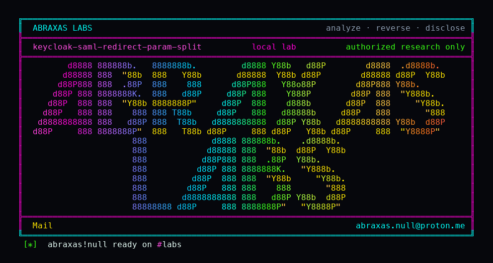

<p align="center">
  
</p>

# keycloak-saml-redirect-param-split

Someone with no Keycloak account can finish a company SAML login as another person. They sign in once at the upstream identity provider, keep that signed redirect, and stick a second SAML document in front of it under a percent-encoded name. Keycloak checks the honest signature and then logs them in as the name in the forged document. This needs a SAML broker that signs HTTP-Redirect responses, with signature validation on and assertion signatures left off, which is what metadata import configures. It is not the semicolon split from [issue #53354](https://github.com/keycloak/keycloak/issues/53354).

**Class:** OAuth leftover
**Reach:** Remote (unauthenticated to Keycloak; needs a redirect-signing SAML broker)

**Keycloak** `26.8.1` (`24ed1dad`) - Red Hat

| | |
|---|---|
| ID | no CVE yet |
| Class | **OAuth leftover** |
| Reach | **Remote** (no Keycloak account; needs one genuine HTTP-Redirect signature from the IdP) |
| CWE | [CWE-287](https://cwe.mitre.org/data/definitions/287.html) / [CWE-347](https://cwe.mitre.org/data/definitions/347.html) / [CWE-116](https://cwe.mitre.org/data/definitions/116.html) |
| CVSS | **High: 7.4** `CVSS:3.1/AV:N/AC:H/PR:N/UI:N/S:U/C:H/I:H/A:N` |
| Product | [Keycloak](https://github.com/keycloak/keycloak) |
| Affected | **26.8.1** (`24ed1dadf3f246a555adb6d3d4a99e9b3003fb3b`); Quarkus 3.40.1; image `quay.io/keycloak/keycloak:26.8.1` |
| Auth | none on Keycloak. Needs a SAML identity-provider broker with `validateSignature=true` and `wantAssertionsSigned` absent or false. |
| License | [GNU Affero GPL v3.0](LICENSE) |
| Lab | `127.0.0.1:18084` only |

## What an attacker can do

Needs the victim NameID (usually an email) and one real signed HTTP-Redirect from that IdP. Does not need a Keycloak password. Does not need a mailbox. A POST-only IdP does not hand over that signature. The GET ACS stays mounted even when metadata import prefers POST.

| Privilege | Method / sink | Recon / integrity / availability | Lab-proven or inferred |
|---|---|---|---|
| Bind a forged SAML document while the honest signature still verifies | GET broker ACS with `SAML%52esponse=<forged>` ahead of signed `SAMLResponse` | Integrity (authn) | Lab-proven. Control email `attacker.kcs04b8n1@lab.test`. Attack email `victim.kcs04b8n1@lab.test` |
| Create the victim user through first-broker-login | `callback.authenticated` on the forged NameID | Integrity (account create) | Lab-proven. Victim count 0 before the split query, 1 after |
| Session as an existing brokered user, including an admin who uses the same IdP | Same ACS, NameID of that user | Integrity (account takeover) | Inferred. Lab created the victim on first login |
| Keep RelayState and the auth session | RelayState stays the signed value | Integrity | Source. Signature covers RelayState |
| Negative control | Honest signed redirect, no extra parameter | n/a | Lab-proven. Control finishes as the attacker email |

**Stays closed on this leftover**

| Axis | Method / sink | Why it is closed |
|---|---|---|
| Integrity | Semicolon split `SAMLResponse=...;SAMLResponse=...` | [issue #53354](https://github.com/keycloak/keycloak/issues/53354). `quarkus.http.use-semicolon-as-query-param-delimiter=false` |
| Integrity | Unsigned assertion when `wantAssertionsSigned=true` | `handleLoginResponse` then requires an assertion signature |
| Integrity | No SAML broker, or POST-only IdP with no redirect signature | Attacker never obtains `SigAlg` + `Signature` on a GET |
| Integrity | Host RCE, unauthenticated Admin REST | Out of class |
| Integrity | Default `VERIFY_PROFILE` name form | Lab-proven as a completion step, not a disproof. The form already holds the brokered email |

## How I found it

I pinned Keycloak **26.8.1**. RESTEasy Reactive takes `@QueryParam("SAMLResponse")` from Vert.x, which percent-decodes query names, so `SAML%52esponse` collapses onto `SAMLResponse` and the first value wins. `verifyRedirectSignature` rebuilds the signed string from `getQueryParameters(false)` on the raw query, where that name stays a different key.

Wrong turns already recorded: treating #53354 as this leftover (percent-encoded name, not semicolon); following ACS 302s in the lab client and dropping `AUTH_SESSION_ID`; reading empty firstName/lastName on `VERIFY_PROFILE` as a miss (the email is already the brokered NameID); a reverse shell. Theatre.

## Lab

Python 3.11+ with [cryptography](https://pypi.org/project/cryptography/). Docker required.

```bash
python3 keycloak-saml-redirect-param-split-Abraxas-Labs.py
```

or:

```bash
cd lab
./run.sh
```

Target **only** `http://127.0.0.1:18084`. Image `quay.io/keycloak/keycloak:26.8.1`. The launcher `chdir`s into `lab/` and execs `run.sh`. The lab IdP is in-process. It never talks to a real identity provider.

```text
IOC image=quay.io/keycloak/keycloak:26.8.1 label-version=26.8.1
IOC serverinfo-version=26.8.1
IOC validate-signature=true want-assertions-signed=absent
IOC review-profile=DISABLED
IOC control-email=attacker.kcs04b8n1@lab.test
IOC victim-before=0
IOC attack-email=victim.kcs04b8n1@lab.test
IOC victim-after=1
SUCCESS KC-H04-SAML-REDIRECT kcs04b8n1
```

## The fix

Verify the same query document the endpoint parses. Percent-decode parameter names before signature reconstruction, or reject a query that contains more than one SAMLResponse after decoding. Turn `wantAssertionsSigned` on for redirect brokers, including the metadata-import path.

## References

- [github.com/keycloak/keycloak](https://github.com/keycloak/keycloak) tag [26.8.1](https://github.com/keycloak/keycloak/releases/tag/26.8.1) (`24ed1dadf3f246a555adb6d3d4a99e9b3003fb3b`)
- [`SAMLEndpoint.redirectBinding`](https://github.com/keycloak/keycloak/blob/26.8.1/services/src/main/java/org/keycloak/broker/saml/SAMLEndpoint.java) (`SAMLEndpoint.java:182-183`, `:779-813`, `:896-914`)
- [`SamlProtocolUtils.verifyRedirectSignature`](https://github.com/keycloak/keycloak/blob/26.8.1/services/src/main/java/org/keycloak/protocol/saml/SamlProtocolUtils.java) (`SamlProtocolUtils.java:216-249`)
- [`KeycloakUriInfo.getQueryParameters`](https://github.com/keycloak/keycloak/blob/26.8.1/server-spi/src/main/java/org/keycloak/models/KeycloakUriInfo.java) (`KeycloakUriInfo.java:147-163`)
- Nearby (not this path): [issue #53354](https://github.com/keycloak/keycloak/issues/53354) semicolon split
- [CWE-287](https://cwe.mitre.org/data/definitions/287.html) · [CWE-347](https://cwe.mitre.org/data/definitions/347.html) · [CWE-116](https://cwe.mitre.org/data/definitions/116.html)

## License

GNU Affero GPL v3.0. See [LICENSE](LICENSE). Loopback lab only. No warranty.

Abraxas Labs
abraxas.null@proton.me

Please credit CVE to Abraxas Labs.
